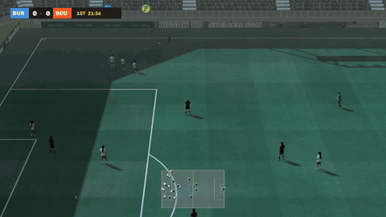
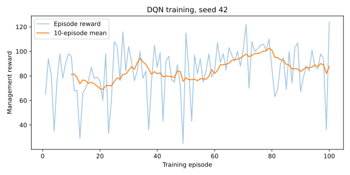
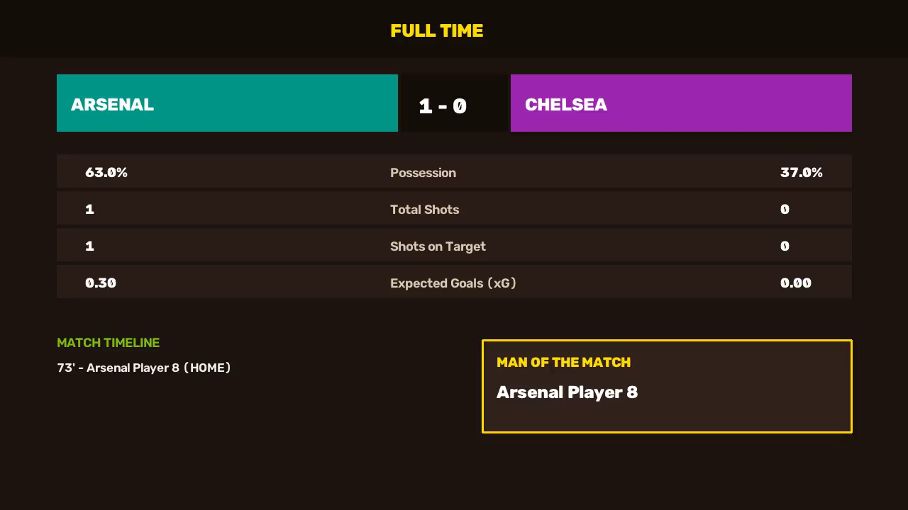
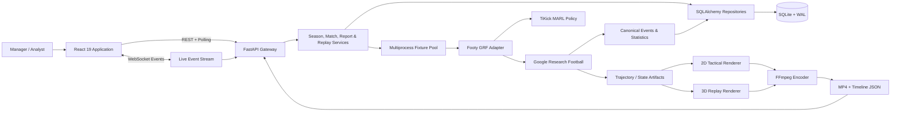
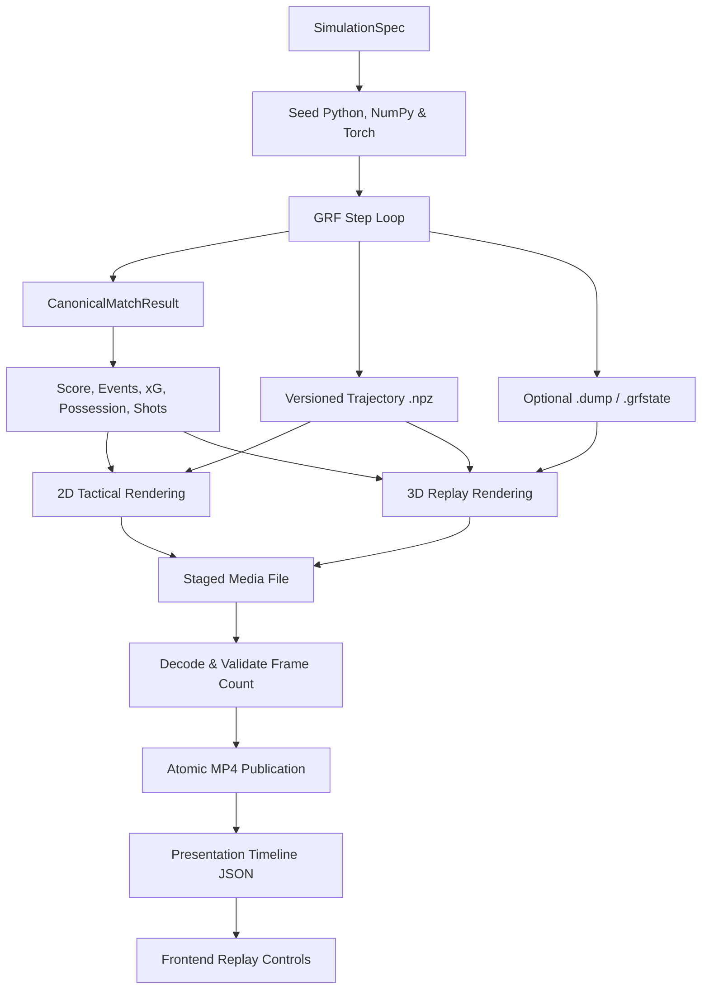

<div align="center">

# ⚽ Footy

### A full-stack football simulation platform powered by Google Research Football

Footy runs 11v11 matches inside Google Research Football, manages entire multi-tier seasons, persists deterministic simulation artifacts, and turns raw environment states into interactive visual analytics and broadcast-style 3D replays.

Built with **FastAPI, React 19, SQLAlchemy, Google Research Football, TiKick, FFmpeg, and PyTorch**.

[](https://github.com/x-Kevin-Paul-x/Footy/actions/workflows/ci.yml)
[](docs/verification_2026_10_13.md)
[](assets/readme/showcase-match.mp4)
[](LICENSE)
[](#tests-and-verification)
[](https://www.python.org/)
[](https://react.dev/)
[](https://www.typescriptlang.org/)
[](https://github.com/google-research/football)

<br/>



**Burnley 2–4 Bournemouth · Match #372 · Fresh 2026 season**

[Watch the full match recording](assets/matches/full-match-recordings/burnley-2-4-bournemouth.mp4) · [Recorded replay timeline](assets/matches/full-match-recordings/burnley-2-4-bournemouth.timeline.json)

**11v11 Multi-Agent Physics** · **Seeded Replay Verification** · **Recorded Match Replays** · **15 Interactive Surfaces**

[Why Footy](#why-footy) · [One Match Flow](#one-match-through-footy) · [Engineering Snapshot](#engineering-snapshot) · [Performance](#simulation-performance) · [Showcase Match](#a-real-generated-match) · [The Platform](#the-platform) · [How It Works](#how-it-works) · [Footy vs GRF](#footy-vs-google-research-football) · [Quick Start](#quick-start)

</div>

---

## Why Footy?

Most football simulators focus either on high-level management logic (calculating match outcomes through probability tables) or on match physics (evaluating isolated reinforcement learning scenarios without persistent consequences).

**Footy explores what happens when both live in the same unified system:** managers make tactical selections and squad rotations, those decisions become simulation parameters, Google Research Football resolves the match via multi-agent reinforcement learning policies, and the resulting physical state is preserved for forensic analysis, 2D tactical breakdowns, and broadcast-style 3D replays.

---

## One Match Through Footy

```text
Manager Decisions (Arsenal vs Chelsea)
      │  Squad selection, tactical roles, and 4-3-3 shape
      ▼
SimulationSpec
      │  Seeded RNG, duration (1,200 steps), and render mode
      ▼
20-Outfield-Agent TiKick MARL Policy
      │  Multi-agent decentralized execution with tactical mirroring
      ▼
Google Research Football
      │  Real 11v11 physics, collisions, ball trajectories, and fouls
      ▼
CanonicalMatchResult (Authoritative Contract)
      ├── Final Score: Arsenal 1–0 Chelsea
      ├── Match Stats: 63% possession · 1–0 shots · 0.30 xG
      └── Event Stream: Goal (Arsenal Player 8, 73')
      │
      ├───────────────────────────────┐
      ▼                               ▼
SQLite Persistence            Trajectory Archive (.npz)
(WAL-mode relational tables)   (Versioned frame state)
      │                               │
      ▼                               ▼
FastAPI & WebSocket Layer      Replay Renderer & FFmpeg
(Live updates & REST endpoints)(Frame decode validation & atomic swap)
      │                               │
      ▼                               ▼
React 19 Analytics & Tables    Broadcast-Style 3D Replay (.mp4)
(Dynamic form & player stats)  (Overlays, clock, scorebug & radar)
```

---

## Engineering Snapshot

| Engineering Surface | Metric / Evidence | Verification Standard |
| :--- | :---: | :--- |
| **Automated Backend Tests** | [Dated verification](docs/verification_2026_10_13.md) | Dated backend, frontend and native verification |
| **Targeted Regression Suites** | **33 passed** | Season contracts, replay loading, squad data, and recording retention |
| **API Surface** | **74 routes** | FastAPI REST endpoints, WebSocket channels, and media streaming |
| **Relational Schema** | **Versioned ORM schema** | SQLAlchemy 2.0 entities, SQLite WAL persistence, tested fresh/legacy Alembic upgrades |
| **Replay Validation** | **1,634 decoded frames** | H.264 High Profile @ 720p 15fps, verified against canonical score |
| **Product Surfaces** | **15 React pages** | React 19, TypeScript, MUI, Recharts, TanStack Query, and Zustand |
| **Simulation Core** | **11v11 Multi-Agent** | Native Google Research Football environment + TiKick neural policy |
| **Codebase Scale** | **40.4k LOC** | 27,637 lines Python (`backend/src` + `backend/tests`), 12,714 lines TS/TSX |

---

## Simulation performance

The current benchmark dispatches the actual GRF worker pool and records observed concurrency. This diagnostic uses two fixtures, 200 steps each, trajectory capture, and two repetitions. Cold batch time includes WSL startup and checkpoint loading; it is not a full-season throughput estimate.

| Requested / observed workers | Batch latency p50 | Steps/second including startup | Canonical hashes |
| --- | ---: | ---: | --- |
| 1 / 1 | 18.77 s | 21.32 | Repeatable |
| 2 / 2 | 9.90 s | 40.41 | Repeatable and equal to one worker |

See [raw native benchmark](docs/evidence/native_benchmark.json). Synthetic concurrency checks are labelled separately and are not GRF performance results. Historical full-season timing is described below with its original workload.

## Manager AI evidence

The management DQN has 24 observation values and five scouting/transfer actions. It is separate from the TiKick policy controlling players. These measurements use the synthetic management environment, six clubs, twenty decisions per episode, and 30 held-out seeds (1000–1029).

| Policy | Mean reward ± standard deviation | Mean points | Mean rank |
| --- | ---: | ---: | ---: |
| DQN, training seed 42 | 78.10 ± 22.30 | 27.03 | 3.93 |
| DQN, training seed 43 | 76.90 ± 20.93 | 26.43 | 3.90 |
| DQN, training seed 44 | 79.20 ± 22.82 | 28.63 | 3.70 |
| Existing DQN checkpoint | 78.30 ± 21.52 | 27.47 | 3.77 |
| Random valid action | 80.87 ± 19.91 | 28.87 | 3.70 |
| Do nothing | 70.97 ± 22.56 | 24.07 | 4.13 |
| Youth focused | 80.47 ± 21.21 | 27.17 | 3.83 |
| Rule based | 85.23 ± 20.62 | 30.33 | 3.57 |

The DQN runs do not establish an advantage over random actions in this sample. The rule-based policy has the highest mean reward. [Raw episodes, seeds, model hashes and uncertainty](docs/evidence/manager_evaluation.json) and [reproduction commands](CONTRIBUTING.md) make that finding inspectable.



## Reliability and management updates

- Accepted simulation and evaluation jobs have persisted IDs, exclusive database ownership, renewable leases, cancellation, and restart reconciliation.
- Saves use SQLite's WAL-safe backup API. Their manifests retain referenced runtime recordings. Restoring a database snapshot invalidates previous job ownership.
- Versioned migrations support fresh databases and existing installations, with consistent pre-migration backups and integrity checks.
- Campaign reports, frozen squad/finance snapshots, and financial ledgers have explicit run identities. The Saved campaigns page exposes retained history.
- Attendance credits cash; broadcasting allocations share a fixed pool; loans move players, split wages and return on expiry. Release clauses and sell-on fees have domain validation and regression coverage.
- Owners distribute surplus cash above the configured annual retention cap to limit runaway transfer funds; the ledger shows those distributions.
- Replay timelines record emitted frames, and publication checks fully decoded frame counts.

## Known limitations

- Native GRF substitutions remain unsupported; the legacy engine's substitutions and stored benches do not prove native substitution support.
- Manager evaluation is synthetic. The tabular manager fallback remains active for decisions outside the five-action DQN path.
- Scoring realism remains under investigation: the retained 380-fixture GRF season averaged 4.93 goals per match, versus 3.28 in the 2023/24 reference. [Calibration report and sources](docs/evidence/calibration.json).
- `FOOTY_DYNAMIC_TACTICS=1` enables deterministic, conditional in-match changes and venue-dependent policy modulation. This experimental profile is opt-in and needs statistical calibration before becoming the default.
- Saves preserve the database and retained artifacts. They do not resume an interrupted in-memory match or automatically reconstruct a live campaign from a snapshot.
- The [read-only demo package](docs/demo/index.html) plays precomputed assets. Public hosting requires enabling GitHub Pages and running its deployment workflow.
- Native Linux tests and the Windows/WSL integration checks have distinct runtime requirements. Skips and actual checks are recorded in [dated verification](docs/verification_2026_10_13.md).

---

## A Real Generated Match

### Latest verified season: Burnley 2–4 Bournemouth

The October 2026 verification run completed all **380 fixtures in 38 minutes 38 seconds** using ten CPU workers and the official TiKick actor checkpoint. An additional native-state audit checked **1,140,380 saved states and all 1,874 goals** without a mismatch. The season simulation saves the authoritative native states; video generation later restores and renders those states without simulating the match again.

The GIF above shows a ten-second excerpt around Bournemouth's opening goal. Its source is the complete match #372 recording: **310.7 seconds, 1280×720, H.264, 10 fps, 37,349,145 bytes (35.62 MiB)**. The full MP4 and its goal timeline are preserved in [`assets/matches/full-match-recordings/`](assets/matches/full-match-recordings/).

Runtime videos, trajectories and native state archives are saved under `backend/reports/recordings/<run_id>/` by default, or `$FOOTY_REPORTS_DIR/recordings/<run_id>/` when a custom reports directory is configured. Timed verification runs use `backend/verification/season_<timestamp>/reports/recordings/<run_id>/`.

**Storage policy:** starting a new simulation deletes previous runtime run directories, including their videos and native archives. The current run and curated files under `assets/matches/` are preserved. `FOOTY_RUN_RETENTION=N` optionally retains N previous runs; the default is zero. Timed verification runs also clear previous verification recordings while keeping their audit summaries and databases.

### Earlier standalone showcase

This repository includes a verified match generated through the real `/api/v1/match/simulate-grf` endpoint on **6 September 2026**. Arsenal beat Chelsea **1–0**, with Arsenal Player 8 scoring at the 73rd minute.

<div align="center">

### **Arsenal 1 – 0 Chelsea**
**63% Possession** · **1–0 Shots** · **0.30–0.00 xG** · **1,634 Validated Frames** · **H.264 720p**

[▶ Watch Complete 3D Replay (MP4)](assets/readme/showcase-match.mp4) · [Inspect Match JSON](assets/readme/showcase-match.json) · [Inspect Presentation Timeline](assets/readme/showcase-match.timeline.json)

<br/>



</div>

<details>
<summary><strong>🔍 Replay Validation Details</strong></summary>

| Render Property | Verified Value |
| :--- | ---: |
| **Resolution** | 1280 × 720 |
| **Frame Rate** | 15 fps |
| **Video Codec** | H.264 High Profile |
| **Duration** | 108.93 seconds |
| **Frames Decoded** | 1,634 |
| **Output File Size** | 3.60 MiB |
| **Overlay Layers** | Lineup card, scorebug, match clock, minimap radar, event badges, full-time statistics |

</details>

<details>
<summary><strong>⚡ Reproduce the Showcase Request</strong></summary>

```powershell
$body = @{
  match_id        = "readme_showcase_arsenal_chelsea_20260906"
  home_team_name  = "Arsenal"
  away_team_name  = "Chelsea"
  home_formation  = "4-3-3"
  away_formation  = "4-2-3-1"
  max_steps       = 1200
  generate_video  = $true
  record_dump     = $true
  render_mode     = "3d"
} | ConvertTo-Json

Invoke-RestMethod `
  -Method Post `
  -Uri "http://localhost:5001/api/v1/match/simulate-grf" `
  -ContentType "application/json" `
  -Body $body
```

</details>

---

## What Footy Does

| Functional Area | Platform Capabilities |
| :--- | :--- |
| **Match Engine** | Native GRF 11v11 physics, TiKick multi-agent policies, tactical formation transforms, seeded deterministic execution, event and touch attribution |
| **Season Simulation** | Double round-robin scheduling, multi-matchday rounds, standings, player fatigue, training, finances, transfers, youth academy, season rollover |
| **Replay System** | Versioned trajectory NPZ, optional GRF state/dump capture, 2D tactical pitch render, 3D broadcast render, FFmpeg encoding, presentation timelines |
| **Football Data** | Goals, shots, expected goals (xG), possession, passes, fouls, cards, substitutions, tactical lineups, player ratings, and historical career logs |
| **Application Layer** | FastAPI REST and WebSocket services, SQLAlchemy 2.0 repositories, SQLite WAL persistence, TanStack React Query, and Zustand client state |
| **Presentation Layer** | Premier League command center, league tables, player profiles, manager profiles, match center, analytics, AI benchmark suite, broadcast overlays |

---

## What Makes Footy Technically Interesting

* **Real 11v11 Physics Simulation:** Matches run inside Google Research Football's native C++ simulation environment rather than resolving via statistical RNG.
* **Multi-Agent Policy Integration:** TiKick neural policies drive 20 outfield agents, alongside GRF goalkeepers, with tactical formations and dynamic behavioral transforms.
* **Deterministic Artifact Pipeline:** Seeded canonical results are checked across repeated execution and worker counts. Replay restores authoritative native states; the scope and limitations of each check are recorded with its evidence.
* **Failure-Aware Media Publication:** Replay video is encoded to isolated staging paths, drained for FFmpeg errors, verified for decoded frame counts, and atomically published.
* **Full-Stack Simulation Observability:** Output flows directly from physics engine → typed canonical domain result → SQLite WAL → FastAPI WebSocket → React 19 visual analytics & 3D playback.

---

## The Platform

Footy features an adaptive interface supporting seamless **GitHub Light and Dark mode** transitions.

<div align="center">

### Premier League Command Center


</div>

<br/>

| 🏟️ Match Center & Timeline | 🏆 League Standings & Form |
| :---: | :---: |
|  |  |
| *Fixture results, search filters, and timeline replay entry* | *Form, goal differential, standings, and financial context* |
| **👤 Player Database & Attributes** | **📈 Analytics & Demographic Curves** |
|  |  |
| *Attribute radar, market value, potential, and records* | *Competition totals, position distributions, and age curves* |

---

## How It Works

### System Architecture



### Simulation-to-Replay Artifact Flow



> 💡 *For execution sequencing, state-machine artifact lifecycles, and persistence invariants, see the comprehensive [01. System Architecture Documentation](docs/01_architecture.md).*

---

## Key Engineering Decisions

### 1. Canonical Coordinate System
* **Problem:** Home and away teams observe opposite attacking orientations. Passing raw observations into tactical policies leads to duplicated logic and orientation-dependent bugs.
* **Decision:** Normalize both sides into a single canonical attacking orientation before policy evaluation, mirroring directional actions once at the environment boundary.
* **Why:** Eliminates duplicate logic, reduces policy branching, and makes symmetry directly regression-testable.

### 2. Single Canonical Match Result
* **Problem:** Having renderers re-parse scores from video frames or having the database calculate match stats independently causes data desyncs between UI tables and video cards.
* **Decision:** `GRFMatchExecutor` emits a single typed `CanonicalMatchResult` contract owning the score, event stream, and statistical attribution.
* **Why:** Renderers, SQLite repositories, and analytics consumers strictly ingest the canonical result, so covered tests can assert agreement across scores, events and replay presentation.

### 3. Run-Scoped Persistence
* **Problem:** Re-running simulation seasons or executing concurrent benchmarks risks clobbering existing match records and media files on disk.
* **Decision:** Relational entities and filesystem paths bind uniqueness to `(simulation_run_id, season_id, match_number)`.
* **Why:** Historical seasons remain accessible while active queries target explicit or current simulation runs without data collisions.

### 4. Atomic Replay Publication
* **Problem:** An interrupted FFmpeg process or encoding error could leave a partial or corrupt MP4 file in the public assets directory.
* **Decision:** Encoders write to isolated staging paths, drain FFmpeg output, validate that the decoded frame count matches the simulation step count, and atomically rename the file into place.
* **Why:** Incomplete media is never exposed to the client or recorded as a valid database artifact.

---

## Footy vs Google Research Football

| Capability | Google Research Football (GRF) | Footy |
| :--- | :--- | :--- |
| **Domain Scope** | Reinforcement learning research environment | End-to-end football management & simulation platform |
| **Simulation Context** | Isolated 90-second scenarios / individual games | Multi-season league with scheduling, fatigue, and transfers |
| **Domain Model** | Raw observation vectors and action integers | Typed football domain models (clubs, players, events, xG) |
| **Artifact Output** | Raw binary `.dump` / `.replay` files | Typed `.npz` trajectories, manifests, and presentation timelines |
| **Visual Presentation** | Headless or basic OpenGL viewport | Broadcast-style 3D video with scorebugs, clock, and radar overlays |
| **Product Interface** | Python script execution | 14-page React 19 visual analytics & control center |
| **Process Model** | Single environment loop | Multiprocess fixture pool with watchdog supervisor recovery |

---

## Quick Start

### 🐳 Zero-Friction Setup (Docker Compose)

The fastest way to launch Footy with both backend and frontend pre-configured:

```bash
git clone https://github.com/x-Kevin-Paul-x/Footy.git
cd Footy
docker compose up --build
```

* **Frontend:** `http://localhost` (Port 80)
* **API Gateway:** `http://localhost:5001`
* **Interactive OpenAPI Docs:** `http://localhost:5001/docs`

---

### ⚡ Local Development Setup

```powershell
# 1. Clone repository & create backend virtual environment
git clone https://github.com/x-Kevin-Paul-x/Footy.git
cd Footy
python -m venv .venv
.venv\Scripts\Activate.ps1
pip install -e ".[dev,ml,media]"

# 2. Launch full stack concurrently (FastAPI on :5001 + React on :5173)
npm install
npm run dev
```

> *The root `npm run dev` script uses `concurrently` to boot the FastAPI backend (`uvicorn`) and the React Vite client simultaneously in a single terminal.*

<details>
<summary><strong>🛠️ Granular Backend & Frontend Manual Launch</strong></summary>

#### Backend Only
```powershell
python -m venv .venv
.venv\Scripts\Activate.ps1
pip install -e ".[dev,ml,media]"
pip install -r requirements-dev.txt
Copy-Item .env.example .env

python backend/src/dev_server.py
```

#### Frontend Only
```powershell
cd frontend
npm install
Set-Content .env 'VITE_API_BASE_URL=http://localhost:5001'
npm run dev
```

</details>

### Compatibility Matrix

| Environment | Status | Verification Context |
| :--- | :---: | :--- |
| **Windows 11 + WSL2 Ubuntu** | ✅ Primary | Primary development host; C++ GRF compilation and rendering verified |
| **Native Linux (Ubuntu 22.04+)** | ✅ Supported | Native execution for both multi-agent simulation and rendering |
| **Windows Native** | ⚠️ Partial | FastAPI backend and React frontend supported; GRF requires WSL2 |
| **CUDA / GPU Acceleration** | Optional | CPU policy inference is standard; GPU acceleration supported for rendering |

---

## Tests and Verification

All tests verified on the configured Windows/WSL host on **6 September 2026**:

| Test Suite | Command | Result | Coverage Area |
| :--- | :--- | :---: | :--- |
| **Backend Integration Suite** | `pytest backend/tests -v` | **95 passed, 9 skipped** | Simulation lifecycle, determinism, and API |
| **Targeted Regressions** | `pytest backend/tests/test_audit_regressions.py` | **23 passed** | Database schema constraints and run isolation |
| **Frontend Jest Suite** | `npm test -- --runInBand` | **6 passed** | Client state transitions and utility transforms |
| **TypeScript Typecheck** | `npx tsc --noEmit` | **Passed** | Strict typechecking across 37 TS/TSX modules |
| **Production Build** | `npm run build` | **Passed** | 2,225 modules transformed in 4.51 seconds |
| **SQLite Schema Health** | `PRAGMA integrity_check;` | **`ok`** | Zero orphaned rows or foreign-key violations |

---

## Repository at a Glance

```text
Footy/
├── .github/workflows/          continuous integration (CI) pipelines
├── backend/
│   ├── alembic/                 database schema migrations
│   ├── benchmarks/              performance measurement harness and results
│   ├── data/                    SQLite database, saves, and match records
│   ├── reports/                 recordings, trajectories, and presentation artifacts
│   ├── src/
│   │   ├── api_fastapi.py       HTTP, WebSocket, and media delivery routes
│   │   ├── database/            SQLAlchemy models, repositories, and sessions
│   │   ├── logic/               GRF runners, replay engine, and season scheduling
│   │   ├── ml/                  DQN manager brain and evaluation routines
│   │   └── models/              football domain entities (clubs, players, fixtures)
│   └── tests/                   unit, regression, and GRF determinism tests
├── frontend/
│   ├── src/components/          formation viewer, replay player, charts, and tables
│   ├── src/pages/               14 product surfaces (dashboard, match center, analytics)
│   ├── src/services/            typed Axios client and WebSocket hooks
│   └── src/store/               Zustand simulation state store
├── assets/readme/               theme-aware screenshots and showcase match artifacts
└── docs/                        detailed architecture, logic, models, and setup guides
```

---

## Documentation

* [01. System Architecture](docs/01_architecture.md) — Detailed layer interactions, sequence diagrams, and lifecycle states
* [02. Backend & Simulation Logic](docs/02_backend_logic.md) — Match executor, season scheduler, and replay pipeline
* [03. Data Models & Artifacts](docs/03_data_models.md) — Relational schema, trajectory specifications, and manifests
* [04. Frontend Guide](docs/04_frontend_guide.md) — Component architecture, state management, and theme system
* [05. Current Implementation Status](docs/05_current_status.md) — Verified test evidence and component health
* [06. Setup & Execution](docs/06_setup_and_run.md) — WSL2 environment configuration and dependency setup
* [07. Backend Remediation Plan](docs/Backend_audit_PLAN.md) — Architectural roadmap and remediation tracking

---

## Current Limitations

Footy is under active engineering development. Known limitations are openly documented and actively remediated in the project backlog:

<details>
<summary><strong>🔍 Known Engineering Limitations & Active Remediation Work</strong></summary>

* **Alembic Bootstrap:** Repairing fresh-database Alembic bootstrap sequence for zero-state database initialization.
* **Durable Job Tracking:** Migrating background simulation and ML tasks to durable job IDs with heartbeat leases.
* **Worker Queue Invariant:** Closing the worker dequeue-before-ownership window in the multiprocessing fixture pool.
* **Frame-Accurate Timelines:** Standardizing presentation timeline generation across 2D trajectory and 3D dump renderers.
* **Pickle Deserialization:** Replacing legacy pickle deserialization with explicit, typed schema validation.
* **Path Containment:** Enforcing resolved path containment across all artifact export and media delivery endpoints.
* **Multiprocess Scaling Harness:** Expanding synthetic benchmarks into distributed multi-node fixture execution.
* **Domain/ORM Class Collision:** Renaming domain `Match` entity shadowing the ORM `Match` model in the API link persistence path.

</details>

---

## Built On & Acknowledgments

* **[Google Research Football](https://github.com/google-research/football)** — Reinforcement learning football simulation environment.
* **[TiKick](https://github.com/OpenDriveLab/TiKick)** — Multi-agent reinforcement learning football policies.
* **[PyTorch](https://pytorch.org/)** — Neural policy execution and tensor manipulation.
* **[FastAPI](https://fastapi.tiangolo.com/)** & **[SQLAlchemy](https://www.sqlalchemy.org/)** — Asynchronous API gateway and relational persistence.
* **[React](https://react.dev/)** & **[MUI](https://mui.com/)** — Component framework and visual design system.
* **[FFmpeg](https://ffmpeg.org/)** — Replay video transcoding and broadcast stream generation.

---

<div align="center">

Built with ⚽ by **[Kevin Paul](https://github.com/x-Kevin-Paul-x)** · Licensed under the **[MIT License](LICENSE)**

</div>
